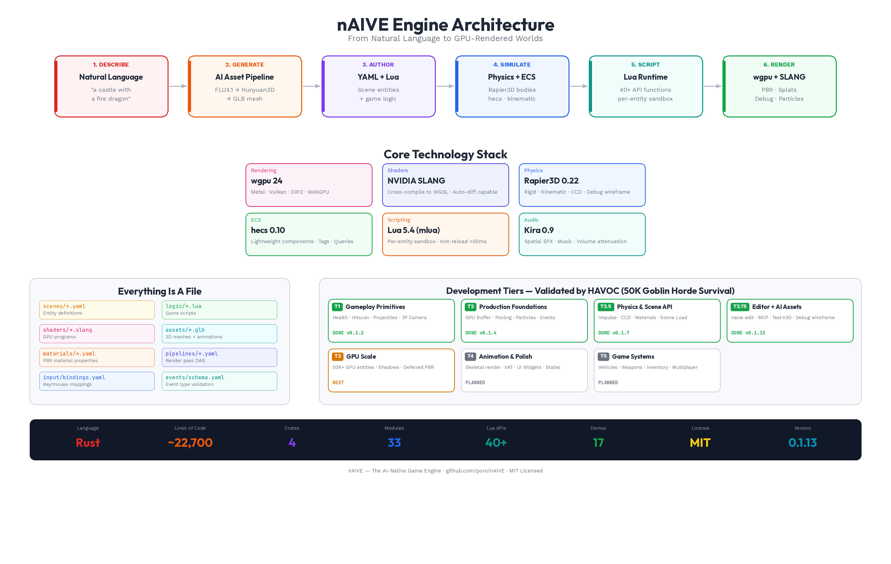

# nAIVE Engine — Architecture Reference

**Version:** 0.1.13
**Date:** March 2026
**Companion:** nAIVE Engine PRD v5.0
**License:** MIT

---

## 1. Architecture Overview

nAIVE is a six-stage pipeline: natural language description becomes a rendered, interactive 3D world. Every stage is file-driven and AI-observable — there is no visual editor. The AI agent *is* the editor.

The engine is built in Rust (2021 edition) across four workspace crates, totaling ~22,700 lines of source across 33 modules. The core technology stack pairs each domain with a best-in-class Rust library: wgpu for cross-platform GPU rendering, NVIDIA SLANG for shader authoring, Rapier3D for deterministic physics, hecs for lightweight ECS, mlua for Lua 5.4 scripting, and Kira for spatial audio.

The development roadmap is organized into tiers, each validated by HAVOC — a 3D Vampire Survivors-style horde survival game designed to push every subsystem to its limit. Tiers 1 through 2.75 are complete as of v0.1.13, covering gameplay primitives, production foundations, physics APIs, editor mode, AI asset generation, and debug visualization. Tier 3 (GPU scale with 50K+ entities and deferred PBR) is next.

### Crate Map

| Crate | Lines | Purpose | License |
|-------|-------|---------|---------|
| `naive-core` | ~1,200 | Scene schema, shared types, YAML deserialization | MIT |
| `naive-client` | ~19,500 | Engine loop, renderer, physics, scripting, world management | MIT |
| `naive-runtime` | ~800 | CLI binary (`naive`, `naive-runtime`, `naive_mcp`) | MIT |
| `naive-server` | ~200 | Multiplayer server (stub — future platform work) | BSL 1.1 |

### Key Modules (naive-client)

| Module | Lines | Responsibility |
|--------|-------|---------------|
| `engine.rs` | 3,480 | Main `Engine` struct, ApplicationHandler, game loop orchestration |
| `pipeline.rs` | 3,057 | CompiledPipeline — YAML-defined render pass DAG, RenderDebugState |
| `scripting.rs` | 1,611 | Lua API registration (40+ functions: physics, entity, camera, events, audio) |
| `shader.rs` | 1,606 | SLANG→WGSL shader compilation, caching, hot-reload |
| `init.rs` | 1,111 | Engine initialization, GPU setup, resource loading |
| `world.rs` | 1,100 | SceneWorld (ECS + registry), EntityCommandQueue, entity spawning, pooling |
| `mesh.rs` | 910 | MeshCache, GLB loading, procedural meshes, vertex colors, skinned meshes |
| `test_runner.rs` | 814 | Headless test runner for `naive test` CLI command |
| `beautify.rs` | 672 | Scene beautification pipeline (simple mesh → Gaussian Splat conversion) |
| `physics.rs` | 652 | PhysicsWorld — Rapier3D wrapper (dynamic, kinematic, static bodies, VHACD) |
| `command.rs` | 594 | MCP JSON-RPC command socket (TCP :6969) |
| `renderer.rs` | 580 | GpuState, DrawUniformPool, instance buffer management |
| `demos.rs` | 553 | 17 embedded demos with interactive CLI browser |
| `input.rs` | 506 | InputState — key/mouse capture, binding system, synthetic injection |
| `ui.rs` | 472 | UiRenderer — text overlay, HUD, flash effects |
| `splat.rs` | 446 | Gaussian Splatting loader and renderer |
| `debug_draw.rs` | 383 | **NEW** — Wireframe physics collider visualization (toggle: H key) |
| `font.rs` | 370 | BitmapFont — SDF text rendering |
| `particles.rs` | ~350 | ParticleSystem — CPU simulation, GPU billboard rendering |
| `camera.rs` | ~300 | CameraState — FPS, TPS, fly-cam modes, shake effects |
| `anim_system.rs` | 185 | Animation system tick, skeletal bone palette computation |
| `editor_camera.rs` | ~170 | Free-fly camera for `naive edit` mode |

---

## 2. Game Loop Pipeline

Each frame follows a strict 12-stage pipeline, designed around a 16ms budget at 60fps. The ordering is deliberate: input and scripts run before physics so that player intent feeds into the simulation, and deferred commands are processed between simulation and rendering to avoid dangling references.

### Frame Stages

1. **Timing** — Compute frame delta, cap to prevent spiral-of-death on long frames.
2. **Hot-Reload** — Check file watchers for scene, script, shader, and material changes. Reload in <100ms.
3. **MCP Commands** — Drain the TCP :6969 command socket. AI agent instructions (spawn, modify, destroy, run Lua) are queued here.
4. **Input Capture** — Read keyboard and mouse state, resolve binding mappings, accept synthetic input injection from MCP.
5. **Scripts** — Call `update(dt)` on every entity's Lua script. Scripts push commands to the EntityCommandQueue rather than mutating the world directly.
6. **Physics** — Step Rapier3D. Supports dynamic, kinematic, and static rigid bodies with CCD. Sync transforms back to ECS components.
7. **Events** — Process collision events into gameplay: apply collision damage, fire death events, invoke Lua event listeners.
8. **Deferred Commands** — Process the EntityCommandQueue. Spawns execute first, then destroys — this ordering prevents dangling entity references.
9. **Animation** — Tick tween system, advance skeletal animations, compute joint palette matrices.
10. **Particles** — Spawn new particles, age existing ones, apply gravity, cull dead particles.
11. **Camera** — Update active camera (FPS/TPS/fly), apply camera shake decay.
12. **Render** — Submit GPU work: PBR forward pass, Gaussian splats, debug wireframes, particle billboards, UI overlay, then present swapchain.

### Deferred Command Architecture

Lua scripts cannot modify the ECS world directly because mlua requires `'static` closures. Instead, scripts push commands to an `EntityCommandQueue`, and the engine processes them at a safe point between simulation and rendering. Spawn commands execute before destroy commands to prevent newly-spawned entities from referencing destroyed ones.

The raw pointer bridge (`*mut PhysicsWorld`, `*mut SceneWorld`) provides zero-cost Lua→engine access without `Arc<Mutex<>>` locking. This is safe because the Engine struct is pinned in the winit event loop, and scene transitions replace the world in-place at the same memory address.

---

## 3. AI Integration Pipeline

nAIVE's defining architectural principle: **the AI agent is the editor**. There is no visual scene editor, property inspector, or node graph. Claude Code (or any MCP-compatible AI) reads a Game Design Document, generates 3D assets, writes YAML scenes and Lua scripts, and manipulates the running engine through a real-time command socket.

### Text-to-3D Asset Generation

The asset pipeline converts a text prompt ("red sports car", "crystal dragon") into a game-ready GLB mesh in four steps: FLUX.1 generates a 2D image fine-tuned for game assets, Hunyuan3D lifts it to a 3D mesh on a self-hosted H100 GPU, the mesh processor smooths normals and extracts vertex colors, and the engine spawns it with VHACD convex decomposition colliders and PBR materials.

Three backends provide redundancy: self-hosted GPU (fastest, full control), HuggingFace Spaces (free tier, queue-based), and Meshy AI API (commercial, consistent quality). Blender MCP handles post-processing when needed.

### MCP Scene Control

The `naive_mcp` bridge process connects Claude Code to the running engine via JSON-RPC over TCP port 6969. Eleven tools provide full scene control: `spawn_entity`, `destroy_entity`, `modify_entity`, `list_entities`, `query_entity`, `run_lua`, `save_scene`, `get_scene_yaml`, `set_camera`, `editor_status`, and `inject_input`.

This architecture means every action the AI takes is observable, replayable, and version-controlled. A session of AI scene-building produces a YAML file and Lua scripts — human-readable artifacts that can be reviewed, modified, and committed to version control.

### Running Engine Subsystems

The editor viewport runs all eight engine subsystems in real-time while accepting MCP commands: Physics (Rapier3D with kinematic and dynamic bodies), Rendering (wgpu PBR + Gaussian splats), Debug Draw (wireframe collider visualization toggled with H key), Particles (CPU simulation to GPU billboards), Scripting (Lua per-entity `update(dt)`), Audio (Kira spatial SFX), Animation (skeletal bones + tweens), and Beautify (scene auto-enhancement).

---

## 4. Rendering & Data Flow

The rendering subsystem is a forward PBR pipeline with plans to evolve into a YAML-defined deferred pipeline DAG in Tier 3. Shaders are authored in NVIDIA SLANG and cross-compiled to WGSL at build time (with hot-reload support during development).

### Scene Loading Pipeline

Scene files (YAML) are deserialized with serde_yaml into `SceneDef` + `EntityDef[]` structs, then spawned into the hecs ECS world. Mesh and material assets are loaded into their respective caches (MeshCache, MaterialCache). Physics bodies are created in Rapier3D — trimesh colliders now use VHACD convex decomposition for proper two-sided collisions. Finally, Lua script sandboxes are created and `init()` is called on each entity.

### Current Render Frame (8 Passes)

1. **ECS Query** — Traverse all entities with Transform + MeshRenderer components.
2. **Uniform Upload** — Write 256 bytes per entity (model matrix, normal matrix, material properties) to the DrawUniformPool. Buffer grows dynamically at 2× with no ceiling.
3. **Forward PBR** — Main geometry pass with depth testing and backface culling.
4. **Gaussian Splats** — Billboard quads with spherical harmonic coefficients for photorealistic splatted geometry.
5. **Debug Wireframe** — Physics collider visualization rendered as LineList topology. Color-coded by shape: box (cyan), sphere (green), capsule (yellow), trimesh (magenta), convex polyhedron (white). Toggled with H key. Has its own WGSL shader and wgpu RenderPipeline.
6. **Particles** — CPU-simulated particles uploaded as GPU billboard quads with color interpolation.
7. **UI Overlay** — Text rendering, line drawing, screen flash, and HUD elements.
8. **Present** — Submit command buffers and present swapchain.

### Shader Compilation Chain

Shaders are written in NVIDIA SLANG (`.slang` files), compiled through the SLANG SDK (vendored in `vendor/`) to WGSL output, then consumed by wgpu to create native GPU pipelines for Metal, Vulkan, DX12, or WebGPU backends. Hot-reload recompiles in <200ms.

### Planned: Deferred PBR Pipeline (Tier 3)

The `pipeline.rs` module (3,057 lines) already contains the `CompiledPipeline` infrastructure for YAML-defined render pass DAGs. Tier 3 will activate this with shadow mapping, G-buffer generation, deferred lighting, Gaussian splat compositing, bloom, ACES tonemapping, and FXAA — all defined as a declarative YAML graph rather than hardcoded render passes.

---

## 5. Physics Architecture

The physics subsystem wraps Rapier3D 0.22 in a `PhysicsWorld` struct that bridges the gap between ECS entity handles and Rapier body/collider handles.

### Body Types

| Type | Builder | Use Case |
|------|---------|----------|
| Dynamic | `RigidBodyBuilder::dynamic()` | Objects affected by forces and gravity |
| Kinematic | `RigidBodyBuilder::kinematic_position_based()` | Game-code-driven movement (platforms, NPCs) |
| Static | `RigidBodyBuilder::fixed()` | Immovable geometry (floors, walls) |
| Character | Kinematic + CharacterController | Player movement with gravity, jumping, slopes |

### Collider Shapes

Primitive shapes (box, sphere, capsule) are created directly from dimensions. Trimesh colliders use VHACD convex decomposition (`rapier3d::parry::transformation::vhacd`) with resolution 256 and concavity 0.002 — this produces proper two-sided collisions instead of hollow meshes. Compound shapes are supported for complex objects.

### Debug Visualization

The `debug_draw.rs` module (383 lines) renders wireframe outlines of all physics colliders directly from Rapier's `collider_set`. Each shape type gets a distinct color for easy identification. The renderer uses its own WGSL shader with `LineList` primitive topology and depth testing enabled so wireframes correctly occlude behind geometry.

### Physics Features

Continuous Collision Detection (CCD) prevents fast-moving objects from tunneling through thin geometry. Raycasting is exposed to Lua for hitscan weapons and line-of-sight checks. Collision events feed into the gameplay event system for damage application and trigger callbacks. Unit tests validate world creation, body addition, and raycasting.

---

## 6. File-Driven Architecture

Everything in nAIVE is a human-readable file that AI can generate, inspect, and modify:

| Path Pattern | Format | Purpose |
|-------------|--------|---------|
| `scenes/*.yaml` | YAML | Entity definitions, transforms, components |
| `logic/*.lua` | Lua 5.4 | Game scripts with `init()` and `update(dt)` |
| `shaders/*.slang` | SLANG | GPU shader programs |
| `assets/*.glb` | glTF Binary | 3D meshes, skeletal data, animations |
| `materials/*.yaml` | YAML | PBR material properties |
| `pipelines/*.yaml` | YAML | Render pass DAG definition |
| `input/bindings.yaml` | YAML | Key/mouse binding mappings |
| `events/schema.yaml` | YAML | Event type validation schema |

This design means a complete game can be code-reviewed in a pull request. Every entity, every shader, every material property is diffable, mergeable, and AI-readable.

---

## 7. Tier Roadmap

| Tier | Name | Status | Key Deliverables |
|------|------|--------|-----------------|
| T1 | Gameplay Primitives | **DONE v0.1.2** | Health, hitscan, projectiles, collision damage, third-person camera |
| T2 | Production Foundations | **DONE v0.1.4** | Dynamic GPU instance buffer, entity pooling, particles, event system |
| T2.5 | Physics & Scene API | **DONE v0.1.7** | Impulse/force, CCD, collider materials, scene loading, camera shake |
| T2.75 | Editor + AI Assets | **DONE v0.1.13** | `naive edit`, MCP command socket, text→3D pipeline, debug wireframe |
| T3 | GPU Scale | **NEXT** | 50K+ GPU compute entities, shadow maps, deferred PBR pipeline |
| T4 | Animation & Polish | Planned | Skeletal mesh rendering, VAT, UI widgets, animation state machines |
| T5 | Game Systems | Planned | Vehicles, weapons, inventory, client-side prediction, multiplayer |

Each tier is validated by building real games — not synthetic benchmarks. HAVOC (50K-goblin horde survival) is the proof game that exercises every system from physics to rendering to AI integration. If it runs HAVOC, it can run anything.
