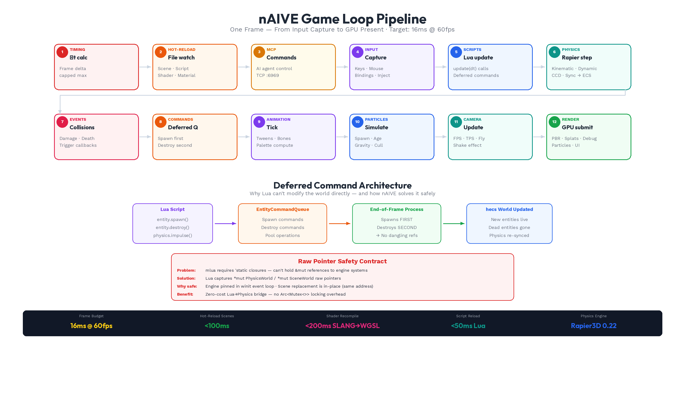
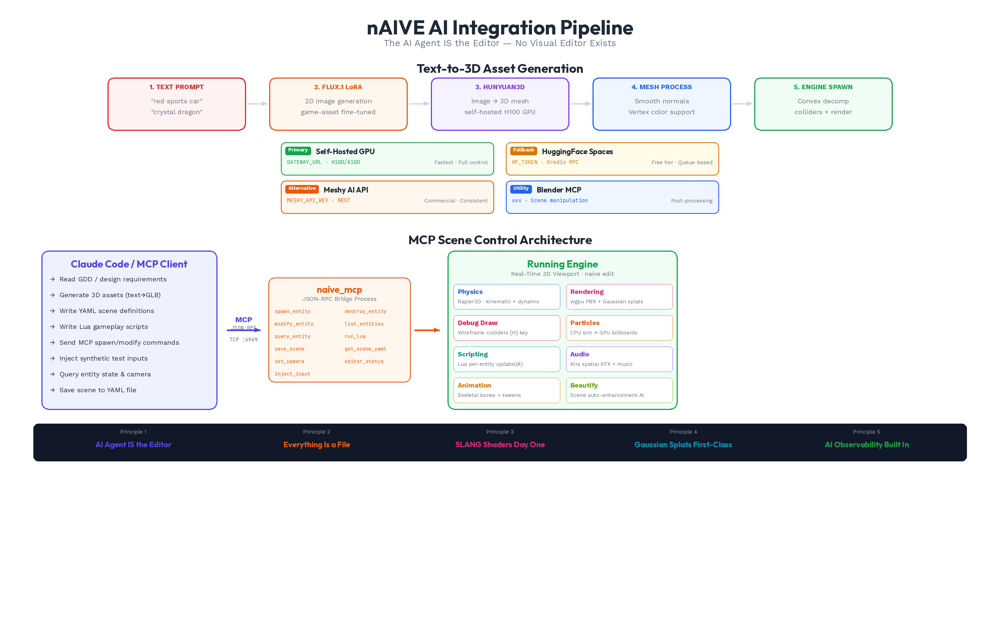
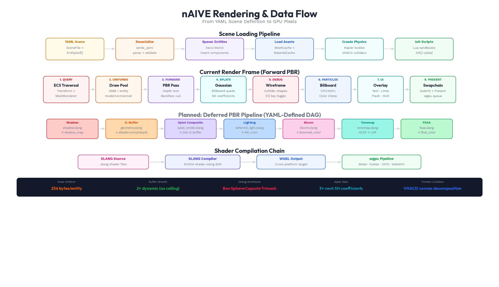

# nAIVE Engine — Architecture Reference

**Version:** 0.1.25
**Reviewed:** November 16, 2026
**Companion:** nAIVE Engine PRD v5.0
**License:** MIT for core/client/runtime/web; BSL 1.1 for the server stub

---

## 1. Architecture Overview

nAIVE is a six-stage pipeline: natural language description becomes a rendered, interactive 3D world. Every stage is file-driven and AI-observable — there is no visual editor. The AI agent *is* the editor.

The experimental engine is built in Rust (2021 edition) across five workspace crates. It uses wgpu for rendering, NVIDIA SLANG for shader authoring, Rapier3D for physics, hecs for ECS, mlua for Lua 5.4 scripting, and Kira for audio. See the README implementation-status table for the distinction between native engine functionality, prototypes and planned platform services.

The development roadmap is organized into tiers, each validated by HAVOC — a 3D Vampire Survivors-style horde survival game designed to push every subsystem to its limit. Tiers 1 through 2.7 are complete as of v0.1.15, covering gameplay primitives, production foundations, physics APIs, editor mode, AI asset generation, pipeline modularization, and debug visualization. Tier 3 (Visual & Interaction — texture mapping, procedural meshes, mouse picking via `screen_to_ray`) is in progress as of v0.1.18. Tier 4 (GPU scale: swarms of 50K+ members simulated and drawn on the GPU, with pathing, combat and spawn waves) is done as of v0.1.21; see `docs/tier4-plan.md`.

### Crate Map

| Crate | Purpose | License |
|-------|---------|---------|
| `naive-core` | Scene schema, shared types, YAML deserialization, typed socket protocol and MCP schemas | MIT |
| `naive-client` | Engine loop, renderer, physics, scripting, world management | MIT |
| `naive-runtime` | CLI binaries (`naive`, `naive-runtime`, `naive_mcp`) | MIT |
| `naive-server` | Multiplayer server stub; no hosting implementation | BSL 1.1 |
| `naive-web` | Minimal WebGPU clear-canvas prototype; not a port of the native runtime | MIT |

### Key Modules (naive-client)

| Module | Responsibility |
|--------|----------------|
| `engine.rs` | Main `Engine` struct, ApplicationHandler, game loop orchestration (`run_frame` → `tick_simulation`, `prepare_render`, `render_frame`) |
| `engine/commands.rs` | Editor/MCP dispatch, entity creation, scene persistence, Lua evaluation, capture, GPU timings and benchmarking |
| `pipeline/` | CompiledPipeline — YAML-defined render pass DAG; split into `def`, `resource`, `compiler`, `executor` and `mod` |
| `scripting.rs` | Sandboxed Lua runtime, resource limits, shared API handles, script loading, hooks and hot reload |
| `scripting/` | Lua API registration by domain: `base`, `input`, `physics`, `entity`, `events`, `audio`, `lifecycle`, `mesh`, `camera`, `particles`, `ui` and `animation` |
| `swarm.rs` | Shared CPU/GPU layouts, region types, swarm targets, flow-field caching, step planning and result reporting |
| `swarm/flow.rs` | Static obstacle rasterization and flow-field pathfinding |
| `swarm/cpu.rs` | CPU reference simulation, deterministic spawning and the headless swarm backend |
| `swarm/gpu.rs` | GPU pipelines, buffers, instanced drawing and asynchronous counter readback |
| `swarm/compute.wgsl` | Swarm binning and steering compute shaders, embedded at compile time |
| `swarm_api.rs` | Lua swarm commands and the request/report bus shared by both backends |
| `shader.rs` | SLANG→WGSL shader compilation, built-in WGSL, caching and hot reload |
| `mesh.rs` | MeshCache, GLB + STL loading, procedural meshes, vertex colors, skinned meshes |
| `world.rs` | SceneWorld (ECS + registry), EntityCommandQueue, entity spawning and pooling |
| `init.rs` | Engine initialization, GPU setup and resource loading |
| `test_runner.rs` | Headless test runner for the `naive test` CLI command |
| `sim.rs` | GPU-free frame steps shared by the engine and test runner: fixed physics steps, collision/event dispatch, damage, projectiles, health, destruction and script updates |
| `beautify.rs` | Scene beautification pipeline (simple mesh → Gaussian Splat conversion) |
| `physics.rs` | PhysicsWorld — Rapier3D wrapper (dynamic, kinematic, static bodies and VHACD) |
| `demos.rs` | Demo scene extraction and interactive CLI browser |
| `command.rs` | Bounded, same-user Unix command socket transport; typed requests and MCP schemas live in `naive-core/src/command.rs` |
| `project_path.rs` | Shared path validation for project reads and writes, including symlink and external glTF resource checks |
| `renderer.rs` | GpuState, DrawUniformPool and instance buffer management |
| `input` | Re-exported from `naive-sim`: InputState, nAIVE's own `Key` and `MouseButton`, bindings and synthetic injection; `engine/winit_input.rs` maps winit events onto it |
| `ui.rs` | UiRenderer — text overlay, HUD and flash effects |
| `splat.rs` | Gaussian Splatting loader, cache and per-entity GPU sort state; `splat/sort.rs` sorts each entity's splats back to front on the GPU |
| `debug_draw.rs` | Wireframe physics collider visualization (toggle: H key) |
| `font.rs` | BitmapFont — SDF text rendering |
| `particles.rs` | ParticleSystem — CPU simulation and GPU billboard rendering |
| `material.rs` | Material system, YAML loader and procedural defaults |
| `reflect.rs` | Component reflection and patch system for hot reload |
| `anim_system.rs` | Animation tick, skeletal bone palette computation |
| `editor_camera.rs` | Free-fly camera for `naive edit` mode |
| `camera.rs` | CameraState — FPS, TPS, fly-cam modes and shake effects |
| `texture_cache.rs` | PNG/JPG/WEBP texture loading and wgpu bind group caching |

---

## 2. Game Loop Pipeline

Each frame follows a strict 12-stage pipeline, designed around a 16ms budget at 60fps. The ordering is deliberate: input and scripts run before physics so that player intent feeds into the simulation, and deferred commands are processed between simulation and rendering to avoid dangling references.

### Frame Stages

1. **Timing** — Compute frame delta, cap to prevent spiral-of-death on long frames.
2. **Hot-Reload** — Check file watchers for scene, script, shader, and material changes. Reload in <100ms.
3. **MCP Commands** — Drain the Unix domain command socket (`/tmp/naive-runtime.sock`). AI agent instructions (spawn, modify, destroy, run Lua) are queued here.
4. **Input Capture** — Read keyboard and mouse state, resolve binding mappings, accept synthetic input injection from MCP.
5. **Scripts** — Call `update(dt)` on every entity's Lua script. Scripts push commands to the EntityCommandQueue rather than mutating the world directly.
6. **Physics** — Advance Rapier3D in fixed 1/120 s steps: as many as the frame's elapsed time calls for (usually one or two, sometimes none), so results do not depend on frame rate. Each script's `fixed_update(dt)` runs before every step. Supports dynamic, kinematic, and static rigid bodies with CCD. Sync transforms back to ECS components.
7. **Events** — Process collision events into gameplay: apply collision damage, fire death events, invoke Lua event listeners.
8. **Deferred Commands** — Process the EntityCommandQueue. Destroys execute first, then spawns, allowing an ID to be destroyed and recreated in the same frame.
9. **Animation** — Tick tween system, advance skeletal animations, compute joint palette matrices.
10. **Particles** — Spawn new particles, age existing ones, apply gravity, cull dead particles.
11. **Camera** — Update active camera (FPS/TPS/fly), apply camera shake decay.
12. **Render** — Submit the compiled deferred pipeline when configured, otherwise the built-in forward PBR fallback; composite splats, debug wireframes, particles and UI, then present.

### Deferred Command Architecture

Lua lifecycle operations push commands to an `EntityCommandQueue`, and the engine processes them between simulation and rendering. Destroy commands execute before spawn commands. Other APIs such as transform and physics setters use scoped borrows through shared handles.

Engine state is shared with Lua via `Rc<RefCell<T>>` handles — `SharedPhysicsWorld`, `SharedSceneWorld`, `SharedEntityCommandQueue`, and friends are defined at the top of `scripting.rs`. This avoids `Arc<Mutex<>>` locking (the engine is single-threaded inside the winit event loop) while still allowing mlua's `'static` closures to mutate engine state. The discipline is to drop every `borrow_mut()` before dispatching events or calling user code that might re-enter; scene transitions reuse the same `Rc` handles, re-initializing their contents in place.

---

## 3. AI Integration Pipeline

nAIVE's defining architectural principle: **the AI agent is the editor**. There is no visual scene editor, property inspector, or node graph. Claude Code (or any MCP-compatible AI) reads a Game Design Document, generates 3D assets, writes YAML scenes and Lua scripts, and manipulates the running engine through a real-time command socket.

### Text-to-3D Asset Generation

The asset pipeline converts a text prompt ("red sports car", "crystal dragon") into a game-ready GLB mesh in four steps: FLUX.1 generates a 2D image fine-tuned for game assets, Hunyuan3D lifts it to a 3D mesh on a self-hosted H100 GPU, the mesh processor smooths normals and extracts vertex colors, and the engine spawns it with VHACD convex decomposition colliders and PBR materials.

Three backends provide redundancy: self-hosted GPU (fastest, full control), HuggingFace Spaces (free tier, queue-based), and Meshy AI API (commercial, consistent quality). Blender MCP handles post-processing when needed.

### MCP Scene Control

The `naive_mcp` bridge process connects Claude Code to the running engine: it speaks MCP (JSON-RPC 2.0) over stdio and forwards each call to the engine's Unix domain socket (default `/tmp/naive-runtime.sock`, set with `--socket`). Eighteen tools provide full scene + runtime control: `naive_spawn_entity`, `naive_destroy_entity`, `naive_modify_entity`, `naive_list_entities`, `naive_query_entity`, `naive_run_lua`, `naive_save_scene`, `naive_get_scene_yaml`, `naive_set_camera`, `naive_editor_status`, `naive_inject_input`, `naive_emit_event`, `naive_query_events`, `naive_runtime_control`, `naive_beautify_scene`, `naive_capture_frame`, which renders the current frame to a PNG so the agent can see the result, and `naive_benchmark` and `naive_gpu_timings`, which measure frame throughput and GPU time per pass.

This architecture means every action the AI takes is observable, replayable, and version-controlled. A session of AI scene-building produces a YAML file and Lua scripts — human-readable artifacts that can be reviewed, modified, and committed to version control.

### Running Engine Subsystems

The editor viewport runs all eight engine subsystems in real-time while accepting MCP commands: Physics (Rapier3D with kinematic and dynamic bodies), Rendering (wgpu PBR + Gaussian splats), Debug Draw (wireframe collider visualization toggled with H key), Particles (CPU simulation to GPU billboards), Scripting (Lua per-entity `update(dt)`), Audio (Kira spatial SFX), Animation (skeletal bones + tweens), and Beautify (scene auto-enhancement).

---

## 4. Rendering & Data Flow

The native renderer supports a YAML-defined deferred render DAG and a built-in forward PBR fallback. Slang shaders compile to WGSL at runtime, including during hot reload. Builds without the `slang` feature use built-in WGSL and do not support runtime Slang compilation.

### Scene Loading Pipeline

Scene files (YAML) are deserialized with serde_yaml into `SceneDef` + `EntityDef[]` structs, then spawned into the hecs ECS world. Mesh and material assets are loaded into their respective caches (MeshCache, MaterialCache). Physics bodies are created in Rapier3D — trimesh colliders now use VHACD convex decomposition for proper two-sided collisions. Finally, Lua script sandboxes are created and `init()` is called on each entity.

### Forward Fallback Render Frame

1. **ECS Query** — Traverse all entities with Transform + MeshRenderer components.
2. **Uniform Upload** — Write 256 bytes per entity (model matrix, normal matrix, material properties) to the DrawUniformPool. Buffer grows dynamically at 2× with no ceiling.
3. **Forward PBR** — Main geometry pass with depth testing and backface culling.
4. **Gaussian Splats** — Each splat's 3D covariance (entity transform, rotation, scale) is projected to a screen-space ellipse, as in 3D Gaussian Splatting, after a back-to-front sort on the GPU. Only the base colour (`f_dc`) is used; higher spherical harmonics are not yet.
5. **Debug Wireframe** — Physics collider visualization rendered as LineList topology. Color-coded by shape: box (cyan), sphere (green), capsule (yellow), trimesh (magenta), convex polyhedron (white). Toggled with H key. Has its own WGSL shader and wgpu RenderPipeline.
6. **Particles** — CPU-simulated particles uploaded as GPU billboard quads with color interpolation.
7. **UI Overlay** — Text rendering, line drawing, screen flash, and HUD elements.
8. **Present** — Submit command buffers and present swapchain.

### Shader Compilation Chain

Shaders are written in NVIDIA SLANG (`.slang` files), compiled through the SLANG SDK (vendored in `vendor/`) to WGSL output, then consumed by wgpu to create native GPU pipelines for Metal, Vulkan, DX12, or WebGPU backends. Hot-reload recompiles in <200ms.

### Implemented, Experimental: Deferred PBR Pipeline

The `pipeline/` module is split across `def`, `resource`, `compiler`, `executor` and `mod`. The supplied `project/pipelines/render.yaml` defines cascaded shadow mapping (`shadows.rs` fits four cascades to the camera each frame; they share one shadow map as a 2 by 2 grid of tiles), G-buffer generation, deferred lighting, splat compositing, bloom, ACES tonemapping and FXAA. `Engine::try_load_pipeline` activates it when available; failed compilation falls back to forward rendering. Runtime Slang compilation requires the SDK.

---

## 5. Physics Architecture

The physics subsystem wraps Rapier3D 0.22 in a `PhysicsWorld` struct that bridges the gap between ECS entity handles and Rapier body/collider handles.

### Body Types

| Type | Builder | Use Case |
|------|---------|----------|
| Dynamic | `RigidBodyBuilder::dynamic()` | Objects affected by forces and gravity |
| Kinematic | `RigidBodyBuilder::kinematic_position_based()` | Game-code-driven movement (platforms, NPCs) |
| Static | `RigidBodyBuilder::fixed()` | Immovable geometry (floors, walls) |
| Character | Kinematic + CharacterController | Player movement with gravity, jumping, slopes |

### Collider Shapes

Primitive shapes (box, sphere, capsule) are created directly from dimensions. Trimesh colliders use VHACD convex decomposition (`rapier3d::parry::transformation::vhacd`) with resolution 256 and concavity 0.002 — this produces proper two-sided collisions instead of hollow meshes. Compound shapes are supported for complex objects.

### Debug Visualization

The `debug_draw.rs` module renders wireframe outlines of all physics colliders directly from Rapier's `collider_set`. Each shape type gets a distinct color for easy identification. The renderer uses its own WGSL shader with `LineList` primitive topology and depth testing enabled so wireframes correctly occlude behind geometry.

### Physics Features

Continuous Collision Detection (CCD) prevents fast-moving objects from tunneling through thin geometry. Raycasting is exposed to Lua for hitscan weapons and line-of-sight checks. Collision events feed into the gameplay event system for damage application and trigger callbacks. Unit tests validate world creation, body addition, and raycasting.

---

## 6. File-Driven Architecture

Everything in nAIVE is a human-readable file that AI can generate, inspect, and modify:

| Path Pattern | Format | Purpose |
|-------------|--------|---------|
| `scenes/*.yaml` | YAML | Entity definitions, transforms, components |
| `logic/*.lua` | Lua 5.4 | Game scripts with `init()` and `update(dt)` |
| `shaders/*.slang` | SLANG | GPU shader programs |
| `assets/*.glb` | glTF Binary | 3D meshes, skeletal data, animations |
| `materials/*.yaml` | YAML | PBR material properties |
| `pipelines/*.yaml` | YAML | Render pass DAG definition |
| `input/bindings.yaml` | YAML | Key/mouse binding mappings |
| `events/schema.yaml` | YAML | Event type validation schema |

This design means a complete game can be code-reviewed in a pull request. Every entity, every shader, every material property is diffable, mergeable, and AI-readable.

---

## 7. Tier Roadmap

| Tier | Name | Status | Key Deliverables |
|------|------|--------|-----------------|
| T1 | Gameplay Primitives | **DONE v0.1.2** | Health, hitscan, projectiles, collision damage, third-person camera |
| T2 | Production Foundations | **DONE v0.1.4** | Dynamic GPU instance buffer, entity pooling, particles, event system |
| T2.5 | Physics & Scene API | **DONE v0.1.7** | Impulse/force, CCD, collider materials, scene loading, camera shake |
| T2.7 | DX & Code Quality | **DONE v0.1.15** | Physics hot-reload, component patch coverage, pipeline modularization, HUD reload notifications, debug wireframes, kinematic bodies, convex decomposition |
| T3 | Visual & Interaction | **IN PROGRESS v0.1.18** | Texture mapping, procedural meshes (cube/sphere/plane/cylinder/cone/torus), STL mesh loading, `screen_to_ray` mouse picking |
| T4 | GPU Scale | Implemented, experimental v0.1.21 | GPU compute swarms, neighbor-grid collisions, flow fields, combat and spawn waves |
| T5 | Animation & Polish | Planned | Skeletal mesh rendering, VAT, UI widgets, animation state machines |

HAVOC is a prototype used to exercise GPU scale and gameplay systems. Its benchmark results describe that scene and hardware; they do not establish readiness for arbitrary production games.

## 8. Module boundaries and validation

`engine/commands.rs` contains editor/MCP dispatch, scene persistence, capture and benchmarking. `naive-core::command` defines typed commands and generates MCP schemas from the same field declarations; the existing flat JSON wire envelope remains compatible. Lua API domains live under `scripting/`; `swarm/` separates GPU resources, flow fields, CPU reference simulation and WGSL.

`project_path` confines scene, asset and output paths to the project, including existing symlink targets. The Unix socket uses owner-only permissions, verifies peer UID, bounds requests and queues, and waits asynchronously for engine responses. Same-user processes are trusted. Concurrent hostile filesystem mutation is outside the project-path helper's threat model.

CI enforces formatting, tests and Clippy with and without Slang, checks WebAssembly, audits dependencies against RustSec, and runs a packaged release smoke test with built-in WGSL on software Vulkan. See [DEVELOPMENT.md](DEVELOPMENT.md).
