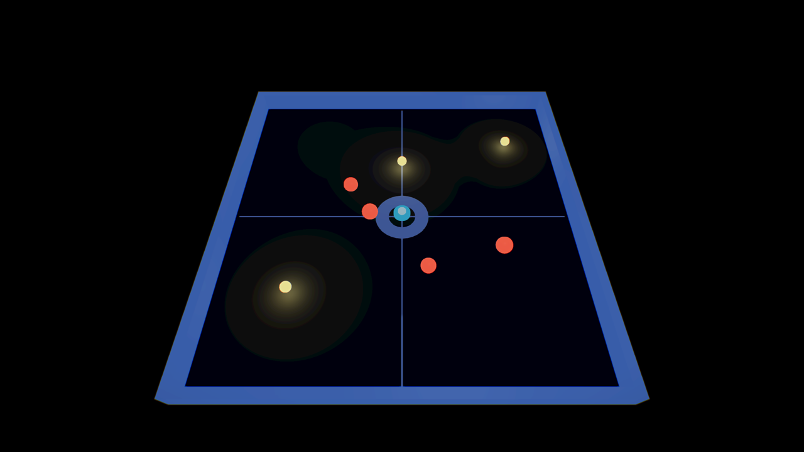

# An agent builds a game: measured

`scripts/agent-benchmark/run.py` measures how long an AI agent takes to build
a small game in nAIVE from a one-paragraph prompt, and what it costs. It
creates a fresh project with `naive init`, gives headless Claude Code
(`claude -p`) the prompt in `scripts/agent-benchmark/prompt.md` with the
`naive` CLI and nAIVE's MCP tools, and then checks the result itself by
running `naive test` in the project.

The prompt asks for "Orb Harvest": a craft steered with WASD on a walled
arena, orbs to collect for points, drifting hazards that cost one of three
lives, a HUD with score and lives, a game-over state, at least three Lua tests
that pass, and a rendering check with a captured frame.

## Run of 2026-11-16

| | |
|---|---|
| Model | Claude Opus 5.5 (`claude-opus-5-5`), Claude Code 2.1.325 |
| Wall time | **3.0 minutes** (173 s reported by the agent) |
| Turns | 25 |
| Tokens | 17,486 output; 1.50 M input, almost all cache reads (1.42 M) plus 78,695 cache writes |
| Cost | **$1.26** at API prices (`total_cost_usd`; on a subscription it counts against the plan instead) |
| Result | `scenes/main.yaml` (186 lines), `logic/game.lua` (254), `tests/test_gameplay.lua` (87). `naive test`, rerun by the script: **6 passed, 0 failed** |



What the agent reported it could not check: the HUD (score, lives, "GAME OVER")
never appeared in a capture, because `capture_frame` leaves out the UI
overlay; the tests cover the values behind it. It also noted that the
headless test runner has no `ui` table, so the script guards its HUD code.

## What this does and does not show

- It is one run. Times and costs vary between runs; run the script a few times
  before quoting a range.
- The agent wrote its own tests, so "6 passed" shows the game meets the
  agent's reading of the prompt, not an independent acceptance test. The
  capture above was taken separately and shows the arena, craft, orbs and
  hazards the prompt asks for.
- It is not a comparison with Unity or Unreal: nothing equivalent was timed
  there. It replaces the old "100x faster" claim with a number that can be
  reproduced: about three minutes and about a dollar for a small tested
  game.

## Running it

```sh
cargo build -p naive-runtime --bins && cargo build -p naive-player
python3 scripts/agent-benchmark/run.py --naive-bin target/debug --budget 10
```

It uses your Claude account, opens engine windows while it works, and keeps
the generated project and a `report.json` in a temporary directory whose path
it prints. `--timeout` limits the agent (default 2,400 seconds);
`--test-timeout` limits each of initialization and `naive test` (default 300
seconds). Cleanup targets the process groups launched by this run, including
engine processes that remain in those groups. Detached processes that start
their own sessions need separate cleanup.

The harness exits nonzero on initialization failure, agent launch failure,
timeout, nonzero agent exit, missing or malformed JSON result, reported agent
error, or test failure. It also rejects an untouched starter project. It
hashes scene YAML and logic/test Lua immediately after initialization and
after the agent, requiring a nonempty added or changed file in each of
`scenes/`, `logic/`, and `tests/`. Deletions, timestamp changes, empty files,
symlinks and unrelated files do not count. These content checks establish
that authoring occurred; they do not judge the gameplay or test quality.

The report separates `agent_success`, `test_success`, and the overall smoke
run `success`. `task_acceptance.status` remains `unverified`: even a successful
run with passing agent-authored tests does not independently establish WASD
movement, scoring, hazards, HUD, game over, or the requested rendering check.
The historical run above predates these harness checks.

Each stage has complete `init`, `agent`, or `tests` stdout/stderr `.log` files,
including partial output on timeout. They stream to disk; report tails are
limited to 4 KiB per stream, and agent JSON parsing is limited to 4 MiB.
Invalid UTF-8 is replaced in report text while raw logs retain the original
bytes. Reports and log artifacts are kept after launch errors and test
errors, too. Complete logs can consume disk space; remove the retained run
directory when it is no longer needed.

The harness regressions run offline with fake CLI executables, with no engine
build or model calls:

```sh
python3 -m unittest discover -s scripts/agent-benchmark -p 'test_*.py' -v
```
